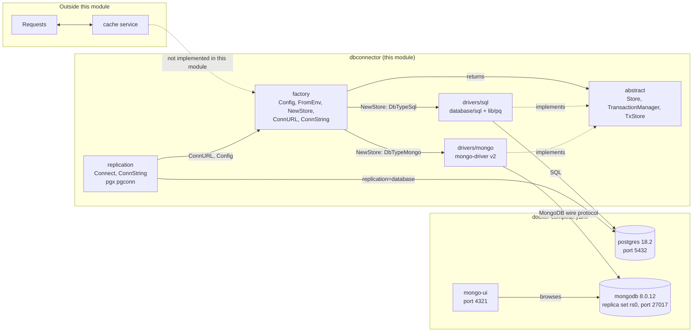

# dbconnector

A small Go module that connects to PostgreSQL or MongoDB. It gives one `abstract.Store` interface for simple CRUD, raw SQL and transactions. For PostgreSQL it also opens logical replication connections. It owns the database connection settings: other programs load them through this module and do not define their own.

Module path: `github.com/champ-isaac/dbconnector`. Needs Go 1.26.

## Contents

- [Architecture](#architecture)
- [What is in it](#what-is-in-it)
- [Quick start](#quick-start)
- [Configure](#configure)
- [Use](#use)
- [Read and write sides (CQRS)](#read-and-write-sides-cqrs)
- [PostgreSQL behaviour](#postgresql-behaviour)
- [MongoDB behaviour](#mongodb-behaviour)
- [Logical replication](#logical-replication)
- [Tests](#tests)
- [Concerns](#concerns)

## Architecture



- A caller builds a `factory.Config` (in code, or from environment variables with `factory.FromEnv`) and calls `factory.NewStore`. The factory picks the SQL or the MongoDB driver by `Config.Type` and returns an `abstract.Store`.
- Both drivers implement `abstract.Store` and `abstract.TransactionManager`, and their transactions implement `abstract.TxStore`.
- `replication` reuses `factory.Config` and `factory.ConnURL`. It does not use the SQL driver, because `database/sql` cannot speak the replication protocol.
- The cache service is shown only for context. Collaboration with it is not implemented in this module.

## What is in it

| Package | What it does |
|---|---|
| `factory` | `Config`, `NewStore(cfg)`, `NewQueryStore(cfg)`, `NewCommandStore(cfg)` and `FromEnv(ctx, prefix)`, which builds a PostgreSQL `Config` from environment variables |
| `abstract` | The `Store`, `TransactionManager` and `TxStore` interfaces, and the two sides `Reader`/`QueryStore` and `Writer`/`CommandStore` |
| `drivers/sql` | PostgreSQL store on `database/sql` and `lib/pq` |
| `drivers/mongo` | MongoDB store |
| `replication` | `Connect(ctx, cfg)` opens a logical replication connection (`replication=database`) |

## Quick start

1. Set the connection variables, or fill `factory.Config` in code (see [Configure](#configure)).
2. Build the config and create a store (see [Use](#use)).
3. Call `Create`, `Read` and the other `Store` methods, and `Disconnect` when you are done.

## Configure

`factory.FromEnv(ctx, prefix)` reads these variables. Each name is the prefix plus the suffix, so one process can hold several servers (`PG_`, `PG_REPLICA_1_`, ...).

| Suffix | Meaning | Default |
|---|---|---|
| `HOST` | server host (required) | |
| `PORT` | server port | `5432` |
| `DB` | database name (required) | |
| `USER` | role name (required: an empty user would make the driver use the operating-system user) | |
| `PASSWORD` | password | empty |
| `SSLMODE` | `disable` or `require`. `require` encrypts but does not verify the server certificate; `verify-ca` and `verify-full` are not supported yet | `disable` |
| `MAX_OPEN_CONNS`, `MAX_IDLE_CONNS` | pool sizes: open at least 1, idle at most open | `10`, `5` (or the open size, if smaller) |
| `CONN_MAX_LIFETIME`, `CONN_MAX_IDLE_TIME` | pool timeouts, such as `30m` | `30m`, `5m` |

`FromEnv` trims leading and trailing white space from every value, `PASSWORD` too, and treats an empty value as unset. A password that starts or ends with a space cannot be set through the environment: fill `factory.Config` in code instead. `FromEnv` reports every bad value at once. The error names the variable and never prints its value, because `PASSWORD` is one of them.

You can also fill `factory.Config` in code (see the `Config` struct). MongoDB has no env loader: fill `Config` with `Type: factory.DbTypeMongo`.

## Use

```go
cfg, err := factory.FromEnv(ctx, "PG_")   // PG_HOST, PG_DB, ...
store, err := factory.NewStore(cfg)       // abstract.Store
defer store.Disconnect()

err = store.Create("accounts", map[string]any{"id": 1, "name": "a"})
rows, err := store.Read("accounts", map[string]any{"id": 1})
```

`Config.Ctx` bounds every call on the store (the `Store` methods take no context of their own) and the pool lives until `Disconnect`. For a call with its own timeout, such as a health probe, build a short-lived store with a `Config.Ctx` that has that timeout and `Disconnect` it afterwards. Column types such as `numeric` and `pg_lsn` come back from `ExecWithSql` as `[]byte` text: cast them in SQL (`::bigint`, `::text`) or parse them.

## Read and write sides (CQRS)

`Store` does everything. To keep reads and writes apart, open each side on its own:

```go
query, err := factory.NewQueryStore(readCfg)     // abstract.QueryStore: Read, Ping, Disconnect
cmd, err := factory.NewCommandStore(writeCfg)    // abstract.CommandStore: Create, Update, Delete, BeginTransaction, Ping, Disconnect
```

- **Own `Config` per side.** Point `readCfg` at a replica or a read-only role and `writeCfg` at the primary. `NewStore` is unchanged and still gives both sides on one connection.
- **The types keep the sides apart.** A `QueryStore` has no write methods and a `CommandStore` has no `Read`. A type assertion to `abstract.Writer` on a query store fails. Code that only reads should take an `abstract.Reader`, and code that only changes data a `Writer` or `TransactionManager`.
- **PostgreSQL also starts the query side read-only.** `NewQueryStore` connects with `default_transaction_read_only=on`, so PostgreSQL refuses a plain write. This stops accidents only: SQL that asks for `BEGIN READ WRITE` overrides it, so it is not a security boundary. To enforce it, give the query `Config` a read-only role or a standby. `factory.QueryConnString(cfg)` returns that connection string for your own pools (it contains the password: do not log it). MongoDB has no such switch: use a read-only user or a secondary in the query `Config`.
- **Reads that must see a command's own writes** run inside its transaction, with the `TxStore.Read` of `BeginTransaction`. A query store behind a replica can lag a commit, so do not read back through it right after a write.
- **Two reads are not one snapshot.** A transfer can commit between two `Read` calls on the query side, so reading both accounts one after the other can show one old and one new balance. Read inside a transaction when the values must agree.
- **Each side has its own connection pool**, sized by its own `Config` (`MaxOpenConns` and the other pool settings apply per side).
- `ExecWithSql` is a query and a command at once, so it stays on `Store` and `TxStore` and is on neither side.
- **Transfer example (`tests/transfer.go`).** `TransferBalanceInMongo(cmd, ctx, from, to, amount)` is the command side and needs only a `TransactionManager`. `ReadBalanceInMongo(query, id)` is the query side and needs only a `Reader`.

## PostgreSQL behaviour

- Table and column names must be plain names (`accounts` or `public.accounts`), otherwise `ErrInvalidIdentifier` is returned. Values always go through `$n` placeholders.
- `Update` and `Delete` refuse an empty filter (`ErrEmptyFilter`) so a bug cannot touch every row. Use `ExecWithSql` on purpose for that.
- `ExecWithSql` returns rows (`[]any` of `map[string]any`) for statements with `select`, `fetch` or `returning`, otherwise the `sql.Result`.

## MongoDB behaviour

- `Update` sets the given fields with `$set` and sends the filter as it is. It does not check how many documents matched.
- `mongo.Inc` (package `drivers/mongo`) changes numeric fields by a delta with `$inc` instead of setting them: `mongo.Inc{"balance": -5}` subtracts 5. It must be used inside a transaction (`BeginTransaction`), and the filter must match exactly one document. MongoDB rejects a field that is not numeric.
- `Store.Update` outside a transaction returns `mongo.ErrIncNeedsTransaction` for an `Inc` and sends nothing.
- Inside a transaction, `TxStore.Update` returns `mongo.ErrEmptyInc` for an `Inc` with no fields (MongoDB would accept an empty `$inc` and change nothing), and `mongo.ErrNonFiniteInc` when a `float64`, `float32` or `Decimal128` value is NaN or infinite (the error names the first such field in name order). Both are returned before anything is sent.
- Inside a transaction, `TxStore.Update` returns `mongo.ErrNoMatch` when no document matched, and `mongo.ErrMultipleMatch` when more than one matched. In the second case the delta was already applied to every match inside the transaction, so call `Rollback`.

```go
tx, err := store.(abstract.TransactionManager).BeginTransaction(ctx)
defer tx.Disconnect()   // aborts the transaction if it is still open
err = tx.Update("accounts", map[string]any{"id": "A"}, mongo.Inc{"balance": -5})   // on an error, call tx.Rollback()
err = tx.Commit()
```

## Logical replication

`database/sql` cannot speak the replication protocol, so `replication.Connect(ctx, cfg)` takes its own `ctx` (not `cfg.Ctx`) and returns a raw `*pgconn.PgConn`. Run the protocol on it with [`pglogrepl`](https://github.com/jackc/pglogrepl):

```go
conn, err := replication.Connect(ctx, cfg)   // same Config as above
defer conn.Close(ctx)
sys, err := pglogrepl.IdentifySystem(ctx, conn)
```

`Connect` works on a server with the default `wal_level=replica`. Creating a logical slot (`CreateReplicationSlot`), and so streaming changes, needs `wal_level=logical`. The role needs the `REPLICATION` attribute (or be a superuser), and `pg_hba.conf` must let it connect to the database like any other connection. `Connect` sets `replication=database`, so `pg_hba.conf` matches it by database name and it needs no `replication` line: that line is only for physical replication (`replication=true`). `replication.ConnString(cfg)` and `factory.ConnString(cfg)` return the URL text for a config (`factory.ConnURL` gives a `*url.URL`). Both contain the password, so do not log them. The pool settings do not apply to a replication connection. The caller owns it and must close it. There is no connect timeout other than `ctx`, so pass one with a deadline.

## Tests

```
go test -race -cover ./factory ./drivers/sql ./replication   # unit tests, 100% coverage
go test -race -cover ./drivers/mongo   # unit tests on an in-process fake MongoDB, no database needed
docker compose up -d postgres && go test -tags integration -run InPostgres ./tests   # real Postgres
go test -tags integration -run InMongo ./tests   # real MongoDB, needs the compose mongodb service (a replica set: transactions need one)
# replication: a server that accepts replication connections (the default wal_level=replica is enough) and a REPLICATION or superuser role:
PG_HOST=127.0.0.1 PG_DB=app PG_USER=u PG_PASSWORD=p go test -tags integration -run ReplicationConnect ./tests
# the slot test creates and drops a logical slot, so it needs a server with wal_level=logical (for example postgres -c wal_level=logical):
PG_HOST=127.0.0.1 PG_DB=app PG_USER=u PG_PASSWORD=p go test -tags integration -run ReplicationSlotCreateAndDrop ./tests
```

CI runs every package with `-race` and requires 90% total coverage. It also runs the `InMongo` tests against a replica set it starts itself (job `integration-mongo`), the `InPostgres` tests against a PostgreSQL service (job `integration-postgres`), and, in job `integration-postgres-logical`, `TestReplicationConnectInPostgres` and `TestReplicationSlotCreateAndDrop` against a server it starts with `wal_level=logical`.

`go.mod` is vendored locally (`vendor/` is not committed). Run `go mod vendor` after changing dependencies.

## Concerns

- Handle large volume size of data write into database
  - for query, create the cache in front of the database server? what the TTL for each cache?
  - build database replicas (master and slave), separate read and write operations
- Collaboration with the cache service is not implemented in this module.
